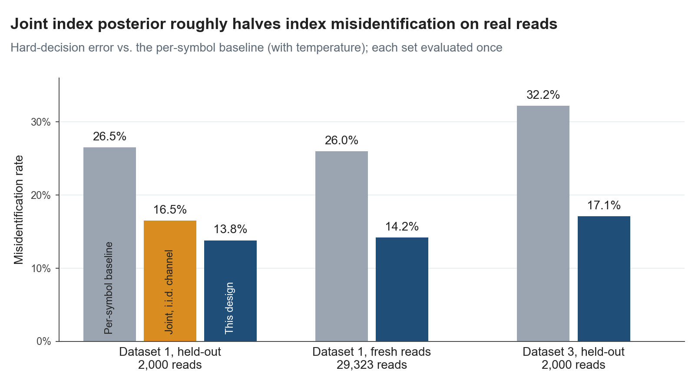

# Index-Level Joint Posterior Decoding for DNA Storage Reads

Every strand in a DNA data store carries a short index, an address saying where in the file it belongs. Sequencing smudges that index with insertions, deletions and substitutions, and a strand whose index is misread gets filed in the wrong place. This repo is about reading the index back from a single noisy read. For linear index codes, the probability of each candidate index can be computed exactly without enumerating the candidates. And scoring the whole index at once, with insertions and deletions modelled jointly and a channel model fitted to real reads, misreads it about half as often as the best per-symbol baseline tested here: 26.5% to 13.8% on held-out reads and 26.0% to 14.2% on fresh reads of one public nanopore dataset, and 32.2% to 17.1% on a public dataset from another lab.



---

## 1. Research question

1. Common index decoders score each candidate index by a product of per-symbol posteriors and are described as feasible only for small pools (enumeration over all M indices). Can the index posterior be normalised exactly at a cost independent of M?
2. Per-symbol products ignore insertion/deletion alignment and channel memory. How much identity information per read is recovered by a joint likelihood over the whole index window, with a channel model fitted to real reads?
3. Does a design fixed on one public dataset carry over to other laboratories, synthesis vendors and sequencing chemistries, and what does it change end to end?

## 2. Approach

- **Metric.** Per-read identity penalty `Pen = E[-log2 q(I | y)]` in bits/read, where `I` is the true index and `q` the decoder's posterior; it is the achievable-rate loss relative to an oracle that knows the index. Hard-decision misidentification rate ε is reported alongside, plus calibration (temperature τ, expected calibration error ECE).
- **Exact, M-independent normalisation.** For a systematic linear index code the per-symbol product posterior is normalised on the code's syndrome trellis; exact top-K lists follow from the same trellis (`code/trellis_index_sim.py`, `code/trellis_topk.py`, `code/trellis_list_size.py`). The joint insertion/deletion posterior is computed on a product trellis "drift × syndrome × flag" (`code/trellis_joint.py`).
- **Measured channel defects.** On the design half of real reads (even cluster numbers), errors were found to come in bursts (after an error, the next position errs 4.4× more often than average), with non-uniform substitutions and context-dependent insertions (`code/channel_fit_dataset1.py`).
- **Design.** A joint index posterior with a two-state hidden channel (good/bad state), a substitution matrix and an insertion preference, on the product trellis "21 drift values × 2 channel states × 2 flags × 64 syndromes" (5,376 states) for linear index codes, and on a prefix tree for unstructured codebooks (`code/channel_model.py`, `code/trellis_hidden_state.py`, `code/evaluate_dataset1.py`). At each strand position the channel emits up to 2 inserted bases followed by a match, substitution or deletion; inserted bases equal the current strand base with probability q_same, and the substitution matrix is shared by both states. Parameters are fitted by Baum–Welch (60 iterations) on 4,000 design-half reads aligned to their strands with banded edit distance (band ±15, reads above 30% edit distance discarded); the temperature is fixed at 1 and the hard decision is the maximum of the joint posterior.
- **Protocol.** The design was fixed on the design half of dataset 1 before the held-out half and the other datasets were opened; held-out reads, fresh reads and the third dataset were each evaluated once. The baseline is the strongest simple decoder found: per-symbol i.i.d. metric plus a temperature selected on the design half.

## 3. Main results

### 3.1 Dataset 1, held-out half

The held-out half of dataset 1 (Microsoft clustered nanopore reads) gives 2,000 reads with M = 10,000 candidate indices. ε of the baseline and the design: `results/frame_error_rate_dataset1_heldout.txt`.

| Decoder | ε | Penalty, calibrated (τ) | ECE (uncalibrated) | Time per read |
|---|---:|---:|---:|---:|
| Per-symbol i.i.d. + temperature (baseline) | 0.2645 | 3.632 (0.6) | 0.069 | 8 ms |
| Joint likelihood, i.i.d. channel | 0.1650 | 1.367 (0.8) | 0.031 | 72 ms |
| Joint likelihood, two-state channel + substitution matrix + insertion preference (design) | 0.1375 | 1.090 (1.0) | 0.015 | 143 ms |

- Paired penalty reduction 2.54 ± 0.10 bits/read (± is the standard error of the paired per-read difference, here and below).
- Of the 2.54-bit reduction, the joint likelihood accounts for 2.26 (89%); the channel state and matrices add 0.28 and remove the need for calibration.

### 3.2 Dataset 1, fresh reads

On 1,997 fresh clusters never used before (29,323 reads), the design has penalty 1.08 bits/read against 3.56 for the baseline (reduction 2.48 ± 0.03); misidentification 26.0% → 14.2%; uncalibrated ECE 0.006.

### 3.3 Dataset 2, held-out half

On 2,000 held-out reads of the DNAformer binned pilot nanopore reads (1,000 strands): penalty 5.02 → 0.65 bits/read (reduction 4.37 ± 0.10), misidentification 48.9% → 7.9% (`results/frame_error_rate_dataset2_heldout.txt`). On this dataset the index window sits at positions 60–69 because the strand start is trimmed by binning; a paired comparison on dataset 1 attributes about 4.8 bits of advantage to a mid-strand window. The summary figure shows dataset 1 and dataset 3, whose index windows lie near the strand start, so the reduction on dataset 2 combines the design with this window effect.

### 3.4 Dataset 3, held-out half

On 2,000 held-out reads of the Welter, Sokolovskii et al. experimental data (M = 30,589): misidentification 32.2% → 17.1%; penalty 4.65 → 1.61 bits/read, a reduction of 3.04 ± 0.11 bits; uncalibrated ECE of the design 0.036.

### 3.5 Cost

On the product trellis for a linear index code, the forward pass takes 11.7 / 11.0 / 12.3 ms per read for M = 10^4 / 10^5 / 10^6 (simulated reads from the design channel); the backward pass is independent of the candidates. Normalisation matches enumeration to 1.8e−15 at M = 200 and 1,000. The unstructured codebook of the real datasets uses a prefix tree (41,542 nodes for the 10,000 indices of dataset 1): the posterior computation on the tree takes 70 ms per read with the two-state channel and 36 ms with one state (`code/prefix_tree_check.py`). The times in the §3.1 table are wall-clock per read for the whole evaluation in `code/evaluate_dataset1.py`.

### 3.6 End to end

A 2,000-strand file in 8 blocks of shortened RS(250, k) over GF(256), with real reads from the fresh clusters of dataset 1 and real coverage non-uniformity (40 draws per coverage). With a perfect inner code and per-strand majority voting, reaching file recovery ≥ 0.9 at outer-code rate 0.8 needs coverage 3.5 with the design and 4.0 with the baseline (12.5% fewer reads); at rate 0.9, 6.0 against 7.0 (`results/end_to_end_summary.txt`). Under the stricter rule, where any contaminated strand counts as an error, the design reaches rate 0.8 at coverage 4.5 while the baseline stays below rate 0.8 up to coverage 8. The same summary file also reports a third readout, which reads the payload back by per-base consensus of the reads' symbol posteriors without an inner code, and index decoding against the file's strands only; the numbers above decode each index against the whole codebook.

## 4. Relation to existing methods

- The drift trellis for insertion/deletion channels follows Davey and MacKay; hidden-Markov channel models with Baum–Welch fitting, syndrome trellises of linear block codes (Wolf), BCJR, prefix trees and temperature calibration are standard components. The contribution here is their combination into an exact index posterior whose cost, for linear index codes, does not grow with M, and its measurement on real reads.
- Welter et al. (IEEE JSAIT 2026, arXiv 2406.12955) take symbol marginals from a strand-level BCJR and score indices by a per-symbol product, enumerating all M indices. Their two-segment VT index code factorises over segments, so its posterior can be normalised in O(√M) without enumeration.
- Srinivasavaradhan et al. (arXiv 2107.06440) note that a product of per-symbol marginals approximates the joint posterior in multi-read reconstruction; this study applies the joint posterior at the index level.
- Learned decoders (DNAformer; TReconLM) report cluster-level strand reconstruction on the Microsoft data.

## 5. Data

The scripts expect the public datasets under `downloads/` next to `code/`:

| Dataset | Source | Licence | Expected location |
|---|---|---|---|
| 1. Microsoft Clustered Nanopore Reads (10,000 strands of 110 nt, 269,709 MinION reads) | GitHub `microsoft/clustered-nanopore-reads-dataset`: `Centers.txt`, `Clusters.txt` | MIT | `downloads/microsoft_clustered_nanopore/` |
| 2. DNAformer Datasets, binned pilot nanopore (Bar-Lev et al., Technion) | Zenodo record 10.5281/zenodo.13896773: `BinnedPilotNanopore.txt` | CC BY 4.0 | `downloads/dnaformer_pilot_nanopore/` |
| 3. Experimental data for "An end-to-end coding scheme for DNA-based data storage with nanopore sequenced reads" (Sokolovskii, Welter; TU München / Chalmers) | Zenodo record 10.5281/zenodo.10943281: `clustered_read_segments.tar.gz` | CC BY 4.0 | extract `file-1_acc-true_passQ-true/` into `downloads/welter_sokolovskii_nanopore/extracted/` |

For dataset 3 the forward reads of `file-1` are used; file names are listed in `results/dataset3_config.txt`.

## 6. Repository layout

```
code/
  trellis_index_sim.py, trellis_topk.py, trellis_index_summary.py, trellis_index_diagnostic.py
      syndrome-trellis posterior, top-k lists, summaries
  trellis_joint.py, trellis_joint_summary.py, trellis_list_size.py
      joint insertion/deletion posterior, list size
  real_reads_dataset1.py
      real-read statistics
  channel_fit_dataset1.py, channel_model.py, trellis_hidden_state.py, prefix_tree_check.py
      channel measurement, hidden-state channel and posteriors, trellis checks
  evaluate_dataset1.py, evaluate_dataset2.py, evaluate_dataset3.py
      evaluation on the three datasets
  dataset_loaders.py, channel_fit_dataset2.py, vt_index_sim.py, frame_error_rate.py
      dataset loaders, channel estimation, VT index, frame-error calculation
  fresh_clusters.py, end_to_end_decode.py, end_to_end_readback.py, reed_solomon.py,
  payload_app_check.py, frame_error_rate_end_to_end.py
      fresh clusters, per-read decoding, end to end, RS codec, payload diagnostic, prediction
results/
  channel_fit_*.txt, frame_error_rate_*.txt, real_reads_*.txt, end_to_end_*.txt
      condensed run logs (fits, frame-error runs, predictions, RS checks)
  end_to_end_summary.txt, dataset3_config.txt
      end-to-end summary table and dataset-3 configuration
figures/
  make_figures.py, summary.png   summary figure
```

## 7. Reproduction

Python 3.10 with `numpy`. Scripts write resumable chunks (`.npz`) under `results/`. Long runs stop after a time budget and continue when run again. For example:

```
python code/evaluate_dataset1.py --source real_design --decoder marg:iid
python code/evaluate_dataset1.py --summary NAME [NAME ...] [--tau_from NAME]
python code/evaluate_dataset2.py
python code/end_to_end_readback.py
python code/end_to_end_readback.py --summary
```

See each script's docstring for its arguments and outputs.

## License

MIT, see `LICENSE`.
